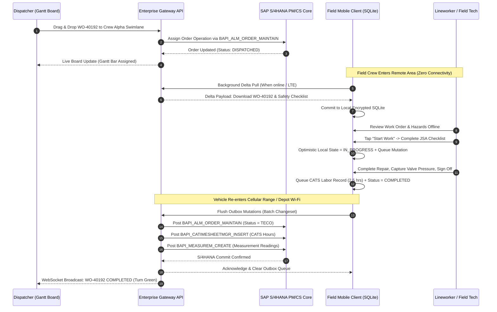

In enterprise asset management, the default recommendation for field mobility is often SAP Service and Asset Manager (SSAM) paired with SAP Multi-Resource Scheduling (MRS) or S/4HANA Resource Scheduling (RSH). 

While these enterprise suites offer vast feature coverage, many organizations—particularly sub-contractor fleets, agile utility divisions, and specialized service operations—face distinct challenges:
- **Excessive Runtime Overhead:** Mobile binaries exceeding 120MB with multi-engine MDK abstraction layers.
- **Complex Sync Mechanics:** Initial offline sync times spanning multiple minutes across low-bandwidth cellular corridors.
- **High Licensing Footprint:** Named-user enterprise ERP licenses required for field crews who only interact with 3 to 4 core maintenance screens.
- **Heavy Dispatch Consoles:** Scheduling interfaces locked inside monolithic SAP GUI transactions or sluggish Fiori launchpads.

To address these pain points, I architected and engineered a **full-stack, standalone field mobility application and real-time Gantt scheduling engine** that interfaces cleanly with **SAP S/4HANA Plant Maintenance (PM) and Customer Service (CS)** without requiring proprietary middleware.

Here is the architectural blueprint of how it was designed, built, and integrated.

---

## 1. Architectural Drivers: Purpose-Built vs. Monolithic

Before writing code, it is critical to evaluate when a custom-engineered architecture makes sense over standard off-the-shelf suites:

| Dimension | Standard Enterprise Suite (SSAM + MRS/RSH) | Custom High-Velocity Architecture |
| :--- | :--- | :--- |
| **Primary Use Case** | Broad, multi-persona enterprise rollouts with extensive ERP master data maintenance. | High-frequency field execution, sub-second response times, and specialized utility workflows. |
| **Client Footprint** | 80–150 MB binary; MDK metadata interpreter on top of native OS engines. | Sub-25 MB optimized native/cross-platform binary compiled directly to machine code. |
| **Offline Architecture** | Heavy OData defining requests; schema complexity tied to full backend data models. | Normalized local SQLite schema holding only active territory operational data. |
| **Dispatch UI** | SAP Fiori / SAP GUI Gantt with strict ERP lock constraints. | Reactive web Gantt console with optimistic UI updates and live WebSocket telemetry. |
| **ERP Coupling** | Dependent on MAIF framework, BTP Mobile Services, and specialized add-ons. | Decoupled via standard SAP BAPIs and OData v4 endpoints honoring Clean Core guidelines. |

By designing an independent layer, we achieve extreme velocity: technicians experience sub-100ms local interaction times, while dispatchers manage crew allocations on a reactive board that streams live field progress.

---

## 2. Data Synchronization & Offline Architecture

Field reliability in substations, rural transmission corridors, and underground vaults requires an **offline-first local persistence architecture**.

```text
┌─────────────────────────────────────────────────────────────────────────────┐
│                       Mobile Client Offline Architecture                    │
│                                                                             │
│   ┌────────────────────────────────┐       ┌────────────────────────────┐   │
│   │   Technician Touch Event       │       │    Background Sync Worker  │   │
│   │   (Tap "Start Work", CATS Time)│       │    (Exponential Backoff)   │   │
│   └───────────────┬────────────────┘       └─────────────┬──────────────┘   │
│                   │ Atomic Write                         │ Non-blocking     │
│                   ▼                                      ▼ Flush            │
│   ┌─────────────────────────────────────────────────────────────────────┐   │
│   │                  Encrypted SQLite Local Store (Cipher)              │   │
│   │  ┌───────────────────────┐  ┌────────────────────────────────────┐  │   │
│   │  │ Operational Entities  │  │ Transactional Delta Outbox (Queue) │  │   │
│   │  │ Orders, Ops, Equip    │  │ Unsynced mutations & timestamps    │  │   │
│   │  └───────────────────────┘  └────────────────────────────────────┘  │   │
│   └─────────────────────────────────────────────────────────────────────┘   │
└─────────────────────────────────────────────────────────────────────────────┘
```

### The Transactional Delta Outbox Pattern
Every user action (changing an order status, logging labor hours, recording a valve pressure reading) is committed immediately to a local **Outbox Table** inside SQLite within a single database transaction:

```typescript
// Sample Mobile Client Mutation Dispatcher
interface QueuedMutation {
  id: string; // UUID v4
  entityName: 'WorkOrder' | 'Operation' | 'TimeConfirmation' | 'Measurement';
  entityId: string;
  actionType: 'CREATE' | 'UPDATE' | 'DELETE';
  payload: Record<string, unknown>;
  createdAt: string; // ISO 8601 UTC
  syncStatus: 'PENDING' | 'IN_FLIGHT' | 'FAILED';
  retryCount: number;
}

export async function recordFieldStatusChange(
  orderId: string, 
  newStatus: 'EN_ROUTE' | 'ON_SITE' | 'COMPLETED',
  notes?: string
): Promise<void> {
  const db = await getEncryptedDatabase();
  
  await db.transaction(async (tx) => {
    // 1. Optimistically update local order state for instant UI reflection
    await tx.execute(
      `UPDATE WorkOrders SET LocalStatus = ?, LastModified = ? WHERE OrderId = ?`,
      [newStatus, new Date().toISOString(), orderId]
    );

    // 2. Commit transactional mutation to offline delta outbox
    await tx.execute(
      `INSERT INTO MutationOutbox (id, entityName, entityId, actionType, payload, createdAt, syncStatus, retryCount)
       VALUES (?, ?, ?, ?, ?, ?, 'PENDING', 0)`,
      [
        crypto.randomUUID(),
        'WorkOrder',
        orderId,
        'UPDATE',
        JSON.stringify({ status: newStatus, timestamp: new Date().toISOString(), notes }),
        new Date().toISOString()
      ]
    );
  });

  // 3. Trigger background sync worker asynchronously (non-blocking)
  SyncWorker.scheduleFlush();
}
```

### Conflict Resolution Strategy
When an order is updated simultaneously by a dispatcher on the scheduling board and a technician offline in the field:
1. **Status Transitions:** Technician field progression (`EN_ROUTE` -> `ON_SITE` -> `COMPLETED`) always takes precedence over administrative board moves.
2. **Schedule Assignments:** If a dispatcher reallocates an unstarted order, the mobile client receives a tombstone delta on next sync, moving the order from the technician's queue gracefully.
3. **Idempotent Transaction IDs:** Every outbox record includes a client-generated UUID, preventing duplicate SAP document creation during network drops and automatic retries.

---

## 3. Scheduling Board Mechanics: Reactive Gantt Dispatching

The dispatcher console was built to provide what legacy SAP scheduling transactions lack: **fluid, real-time visual responsiveness**.

```text
┌─────────────────────────────────────────────────────────────────────────────┐
│                      Dispatcher Real-Time Gantt Console                     │
│                                                                             │
│  Crew / Technician      08:00       10:00       12:00       14:00     Cap.  │
│ ┌───────────────────┬───────────┬───────────┬───────────┬───────────┬─────┐ │
│ │ Crew Alpha (Lead) │ [WO-40192: Transformer] │ [WO-40210: Feeder]  │ 92% │ │
│ │  Status: ON-SITE  │  (Status: In Execution) │  (Dispatched)       │     │ │
│ ├───────────────────┼───────────┴───────────┼───────────┴───────────┼─────┤ │
│ │ Crew Bravo (Gas)  │ [WO-40188: Regulator] │       (Available)     │ 65% │ │
│ │  Status: EN-ROUTE │  (Status: En Route)   │                       │     │ │
│ └───────────────────┴───────────────────────┴───────────────────────┴─────┘ │
└─────────────────────────────────────────────────────────────────────────────┘
```

### Core Scheduling Engine Capabilities:
- **Drag-and-Drop Allocation:** Dispatchers grab unscheduled backlog operations and drop them onto technician swimlanes. The engine calculates estimated travel distance, shift calendars, and qualification matching.
- **Real-Time Back-Propagation:** When a technician in the field taps "En Route" or "Start Work", a WebSocket event updates the Gantt bar color dynamically on the dispatcher's screen within 2 seconds.
- **Work Center Capacity Leveling:** A dynamic capacity bar computes total assigned standard hours against the work center's daily available capacity, alerting coordinators when overtime thresholds are exceeded.

---

## 4. Backend API Design: Clean Core S/4HANA Gateway

To avoid fragile direct database writes or high-cost proprietary middleware, the integration layer talks to SAP S/4HANA via clean REST/OData APIs that wrap standard SAP BAPIs.

### BAPI Wrapper Architecture
Instead of modifying standard SAP tables, the gateway communicates with standard SAP Plant Maintenance function modules executed within strict atomic boundary wrappers:

```abap
" Sample ABAP Integration Handler wrapping BAPI_ALM_ORDER_MAINTAIN
FUNCTION z_field_order_status_update.
*"----------------------------------------------------------------------
*"  IMPORTING
*"     VALUE(IV_ORDER_ID) TYPE AUFNR
*"     VALUE(IV_OPERATION) TYPE VORNR
*"     VALUE(IV_MOBILE_STATUS) TYPE STRING
*"     VALUE(IV_CONFIRMATION_TEXT) TYPE STRING OPTIONAL
*"  EXPORTING
*"     VALUE(EV_SUCCESS) TYPE ABAP_BOOL
*"     VALUE(ET_MESSAGES) TYPE BAPIRET2_T
*"----------------------------------------------------------------------
  DATA: lt_methods   TYPE TABLE OF bapi_alm_order_method,
        ls_method    TYPE bapi_alm_order_method,
        lt_header    TYPE TABLE OF bapi_alm_order_header_e,
        ls_header    TYPE bapi_alm_order_header_e,
        lt_return    TYPE TABLE OF bapiret2.

  " Set Order Status via Business API
  CLEAR ls_method.
  ls_method-refnumber = 1.
  ls_method-objecttype = 'HEADER'.
  ls_method-method = 'CHANGE'.
  ls_method-objectkey = iv_order_id.
  APPEND ls_method TO lt_methods.

  CLEAR ls_method.
  ls_method-refnumber = 1.
  ls_method-method = 'SAVE'.
  APPEND ls_method TO lt_methods.

  CALL FUNCTION 'BAPI_ALM_ORDER_MAINTAIN'
    TABLES
      it_methods = lt_methods
      return     = lt_return.

  " Check return logs and commit
  IF line_exists( lt_return[ type = 'E' ] ).
    CALL FUNCTION 'BAPI_TRANSACTION_ROLLBACK'.
    ev_success = abap_false.
  ELSE.
    CALL FUNCTION 'BAPI_TRANSACTION_COMMIT'
      EXPORTING
        wait = abap_true.
    ev_success = abap_true.
  ENDIF.

  et_messages = lt_return.
ENDFUNCTION.
```

### Resilient Backend Queuing
The gateway maintains an inbound transactional buffer. If S/4HANA undergoes scheduled maintenance or background locking occurs on an order header (`CS-LOCK`), the transaction is kept in a dead-letter retry queue and retried with exponential backoff rather than dropped.

---

## 5. End-to-End Sequence Diagram

The diagram below illustrates the life of a work order: scheduled on the reactive Gantt board, synced offline to the technician's mobile device, executed without connectivity, and flushed back to SAP S/4HANA with automatic status and labor updates.



---

## 6. Technical Learnings & Key Takeaways

Building a custom field mobility platform alongside SAP S/4HANA revealed critical architectural trade-offs:

1. **Keep the Core Clean:** Standard BAPIs and OData services provide all necessary hooks into SAP Plant Maintenance. Avoid custom database tables inside S/4HANA for mobile state; keep transient state in the gateway.
2. **Local Encrypted SQLite is Essential:** Never rely on browser local storage or webview caches for mission-critical utility data. A dedicated SQLite database with write-ahead logging (WAL) ensures corruption-free operations even during hard battery cutoffs.
3. **Decoupled Schedulers Outperform Monoliths:** A dispatcher scheduling 150 crews across 1,000 orders needs instantaneous visual feedback. Decoupling the Gantt UI from synchronous ERP locks eliminates the dreaded 10-second wait between schedule assignments.
4. **Coexistence with SSAM:** A custom solution does not have to be an all-or-nothing replacement. It can serve as a lightweight companion for third-party subcontractors or specific inspection programs, while internal core maintenance teams run standard SSAM.

---

### Need Guidance on Field Architecture or S/4HANA Integration?
Whether evaluating whether to build custom vs. deploy SAP standard SSAM/MRS, designing resilient offline sync mechanisms, or modernizing S/4HANA Plant Maintenance integrations, [reach out for an architectural consultation](/contact).
