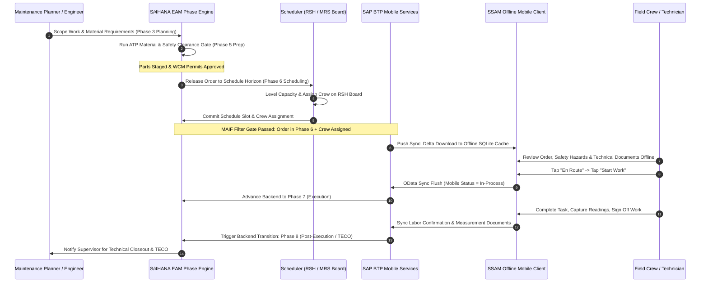

In enterprise asset management (EAM)—particularly within power generation, electric transmission, gas distribution, and water utilities—one of the costliest operational failures is premature dispatch. 

When maintenance work orders are routed to field technicians' mobile devices before engineering reviews are finalized, spare parts staged, permits approved, and switching procedures validated, technicians arrive on-site only to encounter roadblocks. The result is lost wrench time, safety compliance exposure, and frustrated crews.

Historically, organizations attempted to govern this lifecycle using basic SAP Plant Maintenance system statuses (`CRTD`, `REL`, `TECO`) and custom user statuses (`E0001` through `E0010`). However, custom status schemas frequently diverge across plants, lack standardized gating controls, and fail to provide planners with clear visibility into readiness.

With **S/4HANA Asset Management**, SAP introduced the standardized **9-Phase EAM Phase Model**. When architected alongside modern dispatch engines—**SAP Resource Scheduling (RSH)** or **SAP Multi-Resource Scheduling (MRS)**—and synchronized down to **SAP Service and Asset Manager (SSAM)** via the **Mobile Asset Integration Framework (MAIF)**, organizations achieve end-to-end operational governance.

In this architectural guide, we dissect how to design, configure, and synchronize this multi-tier ecosystem.

---

## 1. The Problem with Unstructured Work Orders in Utilities

In high-reliability utility environments, executing a substation transformer oil replacement or a gas valve overhaul requires cross-functional coordination across at least five distinct departments:

- **Reliability Engineering:** Validates failure modes and scopes job requirements.
- **Supply Chain / Warehouse:** Stages specialized gaskets, pumps, and PPE.
- **Safety & Work Clearance Management (WCM):** Authors isolation tags and lockout/tagout (LOTO) permits.
- **Central Dispatch / Schedulers:** Levels crew capacity against travel zones and shifts.
- **Field Operations:** Executes the physical wrench work in the field.

Without strict phase governance, work orders are often prematurely changed to `REL` (Released) simply to issue materials or print shop papers. Because legacy mobile middleware often used `REL` as the sole trigger for mobile dispatch, half-baked work orders flooded mobile queues.

Technicians in remote substations—operating offline hundreds of miles from central depots—would open their mobile tablets only to find:
1. Required safety clearances (WCM operational tags) were still in `PREP` (Draft) status.
2. Long-lead specialized spare parts were backordered with zero warehouse staging confirmations.
3. Required heavy bucket trucks or calibrated dielectric test equipment had not been assigned.

The solution requires a deterministic state machine where mobile dispatch is strictly decoupled from order creation and planning approvals.

---

## 2. S/4HANA EAM Phase Model: 9-Phase Lifecycle & Gate Validations

The S/4HANA Phase Model replaces fragmented user-status spaghetti with a structured, chronological 9-phase lifecycle across notifications and work orders:

| Phase | Phase Name | Description | Key Gate Validations & Control Checks |
| :--- | :--- | :--- | :--- |
| **Phase 1** | **Initiation** | Malfunction detected, initial notification logged | Notification categorization, asset tag verification |
| **Phase 2** | **Screening** | Supervisor review and technical triage | Priority assessment, duplicate detection, accept/reject gate |
| **Phase 3** | **Planning** | Maintenance planner scopes labor, operations & materials | Task list assignment, bill of materials (BOM) explosion, external service requisitions |
| **Phase 4** | **Approval** | Financial authorization and engineering sign-off | Cost estimate validation, workflow sign-off (Flexible Workflow for EAM) |
| **Phase 5** | **Preparation** | Parts staging, tooling reservation, safety permits | Material availability check (`ATP`), tool reservation, WCM lockout permits staged |
| **Phase 6** | **Scheduling** | Operational assignment and crew leveling | MRS Gantt scheduling, RSH Maintenance Schedule Board leveling, shift locking |
| **Phase 7** | **Execution** | Field technicians carry out work on mobile devices | SSAM work order synchronization, travel time, work start, failure mode coding |
| **Phase 8** | **Post-Execution**| Physical work finished, operational review | Technical completion (`TECO`), actual labor confirmations, measurement documents |
| **Phase 9** | **Completion** | Settlement, business close, historical archive | Cost settlement (`KO88`), business completion (`CLSD`), maintenance history archiving |

### Phase-Subphase Control Keys

Each phase consists of granular subphases (e.g., Phase 5 Preparation contains `5.1 Material Check Pending`, `5.2 Materials Available`, `5.3 Safety Clearance Ready`). 

Transitioning from Phase 5 (Preparation) to Phase 6 (Scheduling) requires automated system checks. If an order operation specifies an unconfirmed non-stock component (`RESB-KZEAR = ' '`), the phase engine blocks advancement to Phase 6, ensuring that unstageable work cannot be scheduled on the dispatch board.

---

## 3. Scheduling Architectures: SAP MRS vs. SAP RSH

Depending on asset complexity and operational dispatch topology, utilities employ either **SAP Multi-Resource Scheduling (MRS)** or **SAP Resource Scheduling (RSH)**.

```text
┌─────────────────────────────────────────────────────────────────────────────┐
│                       Dispatch & Scheduling Architecture                    │
│                                                                             │
│   ┌─────────────────────────────────┐   ┌─────────────────────────────────┐ │
│   │    SAP Multi-Resource (MRS)     │   │      SAP Resource Scheduling    │ │
│   │          MRSS / /MRSS/          │   │           (RSH / S/4)           │ │
│   ├─────────────────────────────────┤   ├─────────────────────────────────┤ │
│   │ • Complex qualification matrix  │   │ • Native S/4HANA Fiori engine   │ │
│   │ • Tool / PRT physical tracking  │   │ • Maintenance Schedule Board    │ │
│   │ • Multi-day travel optimization │   │ • Work center capacity leveling │ │
│   │ • Dynamic demand Gantt board    │   │ • Schedule compliance tracking  │ │
│   │ • Direct assignment sync to HR  │   │ • Native CDS View integrations  │ │
│   └────────────────┬────────────────┘   └────────────────┬────────────────┘ │
└────────────────────┼─────────────────────────────────────┼──────────────────┘
                     │                                     │
                     └──────────────────┬──────────────────┘
                                        ▼
                     ┌─────────────────────────────────────┐
                     │   Phase 6 (Scheduling) Gate Pass    │
                     │  Assigned to Work Center / Crew ID  │
                     └──────────────────┬──────────────────┘
```

### SAP Multi-Resource Scheduling (MRS)

SAP MRS (add-on namespace `/MRSS/`) provides high-end optimization algorithms for complex operational scenarios:
- **Qualification Matching:** Validates lineworker high-voltage certifications (SAP HR Qualifications / Infotype `0024`) against operation requirements before permitting assignment.
- **Tool & PRT Integration:** Books physical assets—such as bucket trucks, crane rigs, and specialized SF6 gas recovery carts—ensuring equipment availability alongside human crews.
- **Geographic Routing:** Optimizes transit paths across geographic territories, calculating road speeds and utility corridor constraints.

### SAP Resource Scheduling (RSH / S/4HANA Asset Management)

SAP RSH is the modern, cloud-ready S/4HANA native resource scheduling suite built on SAP Fiori and Core Data Services (CDS):
- **Maintenance Schedule Board:** A dynamic visual interface enabling dispatchers to drag-and-drop operations across weekly scheduling horizons.
- **Work Center Utilization Leveling:** Automatically surfaces overloaded maintenance work centers (e.g., `ELEC-SUB`, `MECH-TURB`) and reallocates operational demands to secondary shifts.
- **Schedule Compliance Metrics:** Measures work executed during the scheduled week versus unplanned break-in work, driving continuous operational improvements.
- **Lightweight Synchronization:** Updates S/4HANA standard assignment tables directly without the data replication overhead of legacy external scheduling engines.

---

## 4. Mobile Interlock (SSAM): MAIF Configuration & Bi-Directional State Synchronization

The linchpin of this architecture is preventing premature order dispatch while maintaining seamless bi-directional synchronization between field technicians using **SAP Service and Asset Manager (SSAM)** and the central S/4HANA core.

### MAIF Distribution Rule Decoupling

In the Mobile Asset Integration Framework (MAIF / Syclo exchange framework configured in transaction `/MERP/CONFIG` or `/SMFND/CONFIG`), standard order distribution algorithms evaluate which work orders belong in a technician's offline SQLite database.

Rather than synchronizing based solely on system status `I0002` (`REL`), we configure the OData filter criteria to check the S/4HANA Phase Model control flags:

```abap
" Example MAIF / OData Distribution BAdI Filter Exit
METHOD /mfnd/if_core_filter_rule~evaluate_order_dispatch.
  
  DATA: lv_phase TYPE i_maintenancerequirementphase-phase,
        lv_subphase TYPE i_maintenancerequirementphase-subphase.

  " Read active Phase & Subphase from S/4HANA EAM CDS view
  SELECT SINGLE phase, subphase
    FROM i_maintenancerequirementphase
    WHERE maintenanceorder = @iv_order_id
    INTO (@lv_phase, @lv_subphase).

  " Business Rule: Only orders in Phase 6 (Scheduling) or Phase 7 (Execution)
  " with confirmed schedule dispatch may be pushed to mobile offline stores.
  IF lv_phase < 6.
    " Order is still in Initiation, Screening, Planning, Approval, or Preparation
    rv_eligible_for_mobile = abap_false.
    RETURN.
  ENDIF.

  " Verify Resource Assignment (MRS / RSH Work Center or Personnel Number)
  IF NOT is_assigned_to_technician( iv_order_id = iv_order_id 
                                    iv_pernr    = iv_technician_pernr ).
    rv_eligible_for_mobile = abap_false.
    RETURN.
  ENDIF.

  rv_eligible_for_mobile = abap_true.
ENDMETHOD.
```

### Real-Time Mobile Back-Propagation

Once an order arrives in SSAM on the technician's mobile device, status updates triggered by the technician propagate backward through SAP BTP Mobile Services to update backend phase-subphase states:

1. **Technician Taps "En Route":** Mobile client issues an OData `PATCH` to the Mobile Status entity. Backend transitions subphase to `7.1 Travel`.
2. **Technician Taps "Start Work":** Safety checks (JSA / Pre-Job Briefing) are verified. Phase is locked into `7.2 In Execution`.
3. **Technician Submits Sign-Off & Measurement Readings:** Field work is completed. SSAM flushes operation confirmations (`AFRU`) and measurement documents (`IMRG`).
4. **Automated Phase Trigger:** The backend automatically advances the order to **Phase 8 (Post-Execution)**, notifying the maintenance supervisor to perform technical review and initiate `TECO`.

---

## 5. End-to-End Architecture Data Flow

The following sequence details how work orders advance through the phase gates, schedule boards, BTP Mobile Services, and the offline SSAM database:



---

## Summary & Architectural Best Practices

Integrating the S/4HANA EAM Phase Model with modern scheduling engines (MRS / RSH) and mobile field execution (SSAM) delivers measurable operational improvements for asset-intensive enterprises:

- **Eliminates Dry Runs:** Field technicians only receive work orders whose parts, clearances, and tool reservations have passed rigorous pre-execution gates.
- **Real-Time Dispatch Visibility:** Maintenance leadership gains an unambiguous, live snapshot of where every work order sits across the 9-phase pipeline.
- **Clean Core Compliance:** Built on standard SAP S/4HANA CDS Views, standard MAIF integration exits, and standard BTP Mobile Services OData v4 offline sync without brittle custom modifications.

Implementing this architecture transforms field workforce productivity from reactive firefights into predictable, audited, high-precision maintenance operations.
